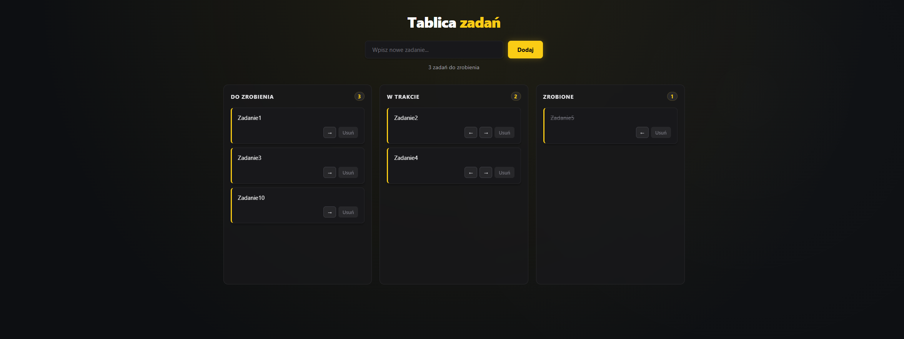

# Aplikacja do zarządzania zadaniami

Prosta adresplikacja do zarządzania  zadaniami w formie tablicy podzielonej na 3 kolumny: **Do zrobienia**, **W trakcie** oraz **Zrobione**.



## Główne funkcje

- **Przesuwanie zadań**: Możliwość zmiany statusu zadania za pomocą przeciągania myszką (**Drag & Drop**) lub za pomocą przycisków strzałek (← / →).
- **Zapisywanie danych**: Zadania są automatycznie zapisywane w pamięci przeglądarki (`localStorage`)
- **Dodawanie i usuwanie zadań**

## Użyte technologie

- **React**
- **Vite**
- **HTML5 Drag and Drop API**

## Uruchomienie

1. Sklonuj repozytorium:
   ```bash
   git clone https://github.com/JakubDolas/ToDoApp.git
   ```
2. Wejdź do folderu z projektem:
   ```bash
   cd ToDoApp
   ```
3. Zainstaluj biblioteki:
   ```bash
   npm install
   ```
4. Uruchom aplikację:
   ```bash
   npm run dev
   ```
5. Uruchom `http://localhost:5173`